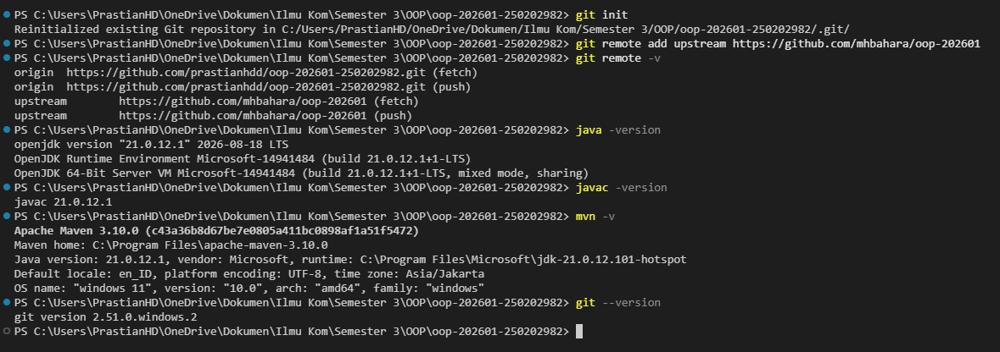
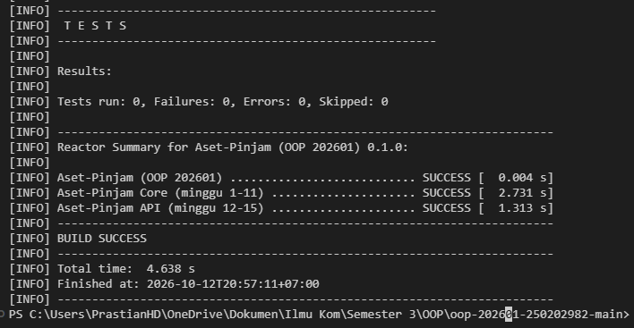
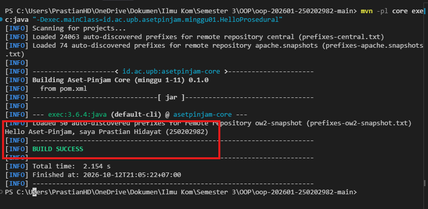

# Catatan Minggu 01: Paradigma Pemrograman dan Setup

## Yang saya kerjakan

Saya mempelajari perbedaan paradigma prosedural, OOP, dan functional melalui program sapaan Aset-Pinjam. Saya membaca struktur tiga class minggu 1 serta tes `Minggu01Test` untuk memahami hasil yang diwajibkan. Saya juga menyiapkan rancangan agar ketiga implementasi menghasilkan teks yang sama dan memuat nama serta NIM.

Status saat catatan dibuat: implementasi tiga class dan data pada `mahasiswa.properties` masih perlu diselesaikan, kemudian diverifikasi dengan `scripts/uji.ps1`.

Praktikum ini harus lolos tools sebagai berikut
1. Java/JDK21 ( paste ke cmd -> `winget install --id Microsoft.OpenJDK.21 --exact` )
2. Maven ( Download -> https://maven.apache.org/download.cgi -> pilih Binary zip archive )
3. Git

Pastikan semua dimasukan ke System Environment dengan cara : Start → cari Edit the system environment variables → Environment Variables.
kemudian verifikasi

```text
java -version
mvn -v
git --version
```

## Keputusan desain

Saya memilih format sapaan berikut untuk ketiga paradigma:

```text
Hello Aset-Pinjam, saya <nama> (<nim>)
```

Format yang sama digunakan agar perbedaan hanya terletak pada cara program dibangun, bukan hasil akhirnya. Gaya prosedural menggunakan method statis, gaya OOP menyimpan nama dan NIM dalam field private, sedangkan gaya functional menghasilkan lambda bertipe `Function<String, String>`.

## Kendala

Saya perlu memahami seluruh codebase atau repository ini untuk mata kuliah OOP 20261. Saya juga perlu memahami bahwa ketiga gaya wajib menghasilkan `String` yang persis sama meskipun struktur implementasinya berbeda. Saya mengatasinya dengan membaca assertion pada `Minggu01Test` dan menelusuri cara pemanggilan setiap method. Kendala teknis lain akan saya tambahkan setelah implementasi dan pengujian selesai.

## Penggunaan AI

- Alat yang dipakai: Claude.
- Bagian yang dibantu AI: Memahami garis besarnya mata kuliah OOP ini, menginstall tools apa yang diperlukan untuk praktikum ini, dan memberi contoh satu implementasi `HelloOOP`.
- Prompt utama:
  1. `Ini adalah mata kuliah Object Oriented Programming. Pahami garis besar matakuliah ini.`
- Satu hal yang saya pahami lebih baik sekarang: paradigma yang berbeda dapat menghasilkan keluaran sama, tetapi cara menyimpan data dan membentuk perilakunya berbeda.

## Dokumentasi


---



---

