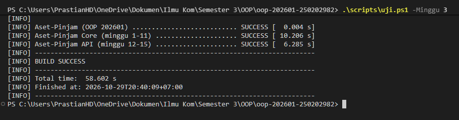

# Catatan Minggu 03: Inheritance

## Yang saya kerjakan

Setelah membaca dokumen minggu 03, tugasnya adalah membuat  class dan memakai ulang kode dari class induk. Materi tersebut diterapkan dengan melengkapi Ruang, Laptop, dan AlatLab sebagai turunan dari Aset. Data umum seperti kode, nama, status, dan kondisi tetap dikelola oleh Aset, sedangkan setiap turunannya menambahkan data yang sesuai dengan jenisnya. Masing-masing class juga mempunyai getJenis() agar jenis asetnya dapat diketahui.

## Keputusan desain

- Kode, nama, status, dan kondisi tetap berada di Aset karena dipakai oleh semua jenis aset. Data tersebut tidak ditulis ulang pada setiap subclass.
- Kapasitas hanya ditempatkan di Ruang, spesifikasi dan nomor inventaris di Laptop, laboratorium dan tingkat risiko di AlatLab.
- Constructor setiap subclass memanggil super(kode, nama) agar pengisian dan pemeriksaan data umum tetap menggunakan kode induk.
- Data khusus dibuat private dan dibaca melalui getter. Data tersebut tidak diberi setter karena perubahan setelah object dibuat belum diminta pada tugas ini.
- Kapasitas harus lebih dari nol, data teks tidak boleh kosong, dan tingkat risiko tidak boleh null. Pemeriksaan kode dan nama dari minggu 2 tetap berlaku.


## Kendala

Pada pengujian lokal tanggal 23 Oktober 2026, gabungan tes minggu 2 dan 3 berhasil: 14 tes lulus tanpa kesalahan. Delapan di antaranya memeriksa tugas minggu 3, termasuk data khusus tiap jenis dan validasi yang tetap berlaku dari Aset. Pengujian dijalankan melalui Claude Code dengan perintah berikut:

```powershell
.\scripts\uji.ps1 -Minggu 3
```

## Penggunaan AI

- Alat yang dipakai: Claude.
- Bagian yang dibantu AI: saya memakai Claude sebagai alat bantu dalam tugas inheritance. Bantuan yang saya minta berupa kode untuk Ruang, Laptop, dan AlatLab, disertai penjelasan  tentang super dan hubungan dengan Aset. Hasilnya tetap perlu saya pelajari dan periksa sesuai materi minggu ini.
- Prompt utama: "Penjelasan materi minggu 03 tentang super class atau induk dan class".
- Yang saya ubah atau tolak dari saran AI, dan alasannya: 
- Satu hal yang saya pahami lebih baik sekarang: kode dan nama cukup disimpan di class Aset, lebih simple dalam penulisan kode 


## Dokumentasi


